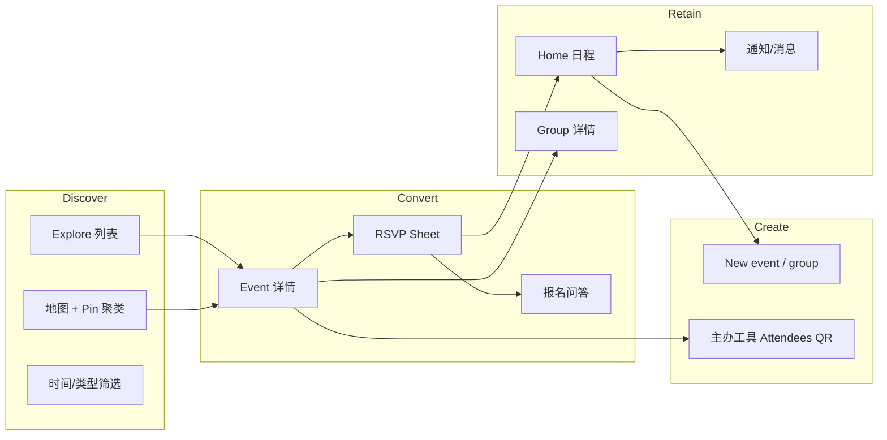

# Meetup iOS 设计语言研究（Mobbin 全量截图）

**日期**：2026-10-15  
**证据**：本地 Mobbin 导出 `Meetup iOS _ Mobbin`（146 张，1179×2556）  
**方法**：全量元数据扫描 + 约 40 张分层抽样读屏 + 色彩启发式聚类  

---

## 摘要与建议

Meetup iOS 是一套**「线下真实感 + 线上轻社交」**的产品视觉：大图活动摄影承担情绪，**品牌紫**只用在「选中 / 链接 / 主操作」，其余界面尽量贴近 **iOS 原生灰白体系**；**黑色胶囊主按钮**用于不可逆或强提交（Next、Continue、Attend、Ticket）；信息架构围绕 **Explore 发现 → Event 详情 → RSVP → Home 回访 → Group 归属** 闭环。

若要在 TopTop 或本仓库原型中「吸收」而非「抄袭」：

| 建议采用 | 建议慎用 / 避免 |
|----------|------------------|
| 列表↔地图双模 + 底部预览卡 | 全屏强插画 Hero（Meetup 活动卡以外较少用） |
| 时间维度一级筛选（Today / Weekend） | 过多紫色大面积铺底（仅 Home 淡紫底） |
| Hero 图 + 紫色状态条（going / hosting） | 黑色全屏功能卡（仅 QR 等强场景） |
| Sheet 完成多步表单（报名、改出席） | 照搬 Meetup 橙地图 Pin（强品牌绑定） |
| 群组卡片：评分 + 成员叠头像 + See all | 混杂第三方截图进设计库（见异常说明） |

**下一步验证**：挑 1 条 TopTop 活动/房间发现流，用下表 Token 做一屏「Meetup 式」线框对照，再跑 `toptop-design-review` 看 Kit 缺口。

---

## 研究范围与证据限制

- **范围**：Mobbin 批次的 Meetup iOS 界面，覆盖发现、注册、活动、群组、主办、通知等主路径。
- **限制**：
  - 文件扩展名为 `.png`，实际为 **WebP**，需 PIL/转换后做视觉分析。
  - Mobbin 顺序≈用户浏览路径，**不等于**官方 IA 文档。
  - **#8** 为 Airwallex 登录页，已从风格结论中排除。
  - 部分头像/姓名在 Mobbin 上被打码模糊。

---

## 品牌与视觉个性

### 一句话

**温暖的照片墙 + 克制的紫色导航锚点 + iOS 系统组件外壳。**

### 色彩（从截图归纳的语义，非官方 Token）

| 角色 | 近似表现 | 用法 |
|------|-----------|------|
| Brand primary | 饱和紫 `#6B5CE6` ~ `#6C47FF` | 选中 Tab、文字链、Filter 角标、圆形确认钮 |
| Brand surface | 极浅紫灰 `#F8F7FF` 系 | Home 背景、促销卡底 |
| CTA strong | 纯黑 `#000` 填充 + 白字 | Onboarding Next、Attend、部分 Continue |
| CTA soft | 浅灰填充 + 黑字 | 未激活 Continue、次要行按钮 |
| Map accent | 橙色 Pin | 地图聚类（Apple Maps 底图） |
| Semantic | 粉日历标、橙定位标、红星评分 | 元信息行左侧图标色 |
| Link | 系统蓝 | 政策链接、空状态「See event list」 |
| Error | 红字 | 举报确认校验 |

紫色**从不**与黑色主按钮抢同一层级：紫=导航/状态，黑=提交。

### 字体与层级

- **SF Pro** 体系：大标题 Bold（活动名、页面问句），正文 Regular，元信息缩小 + 灰色。
- 活动标题常 **2 行截断**；主办/群组名一行加粗。
- Section 标题（Events、Your groups）左粗体 + 右 **紫色 See all**。

### 圆角与阴影

- 搜索栏、筛选 Pill、活动卡：**大圆角（约 12–20pt）**。
- Sheet：**顶部圆角 + 拖拽条**。
- 卡片：**轻阴影**或仅靠白底与浅灰背景分离。
- 底部 Tab：**磨砂底 + 选中项白色/浅色胶囊**（Home 更明显）。

### 影像策略

- **活动**：全宽 Hero 摄影（ picnic、酒吧、线上活动海报）。
- **无图活动**：插画 Banner（如媒体行业 Teal 插画）。
- **群组**：方角 Logo 块 + 有时「10 YEARS」类徽章。
- **个人页**：全屏封面图 + 居中圆形头像（强个性）。

---

## 信息架构（从 146 屏串联）



### 主导航（底部 5 Tab）

Home · Friends（带数字角标）· Explore · Notifications · Messages  

- **Explore**：发现主战场（列表/地图）。
- **Home**：已加入群组、即将开始的活动、Check-in、Pro 推广。
- 选中态：图标 + 标签，Explore/Notifications 用紫色强调。

---

## 组件模式库（可迁移）

### 1. 发现顶栏

- 圆角搜索：「Search events or groups…」
- 右侧 **Filter**，紫色圆点显示已选条件数。
- 下一行 **时间 Pill**：Upcoming | Today | Tomorrow | Weekend（选中=紫底白字）。
- 再下一行 **类别 Tab**（下划线）：All Events / New Groups / Your groups…

### 2. 活动列表卡

- **全宽图** → 标题 → 一行元数据：`DAY • TIME • 距离 • by 主办 • ★评分`
- 底行：**头像叠 + N going**；地图上模式有 **Map** 浮动钮。
- 卡片间留白大，**内容优先于 chrome**。

### 3. 地图模式

- Apple Maps 全屏；橙色 **数字 Pin** 表密度。
- 顶栏收窄为「Events + 城市」；**Search this area** 浮动白 Pill。
- 底部 **白色预览卡**：标题、时间、主办、缩略图、going、分享/收藏。
- **Back to list** 紫色底栏按钮——明确的模态切换 affordance。
- 空状态：放大镜图标 +「No results」+ 链到列表。

### 4. 活动详情页（核心模板）

- Nav：返回 | Event | 分享 + 心形。
- **Hero 图**（圆角顶）。
- **紫色横幅**（状态文案）：  
  - `You +N guests are going…`  
  - `You're hosting` / `Event featured` / `You're not going anymore`
- 标题 → **图标行**（日历粉 / 定位橙）→ **主办灰卡**（小图 + 名 + ★ reviews）。
- 描述短句，可 Read more。
- **底栏固定**：价格/状态 + **黑按钮**（Attend / Ticket / Join Waitlist）；已出席时 **You're going!** 浅紫条 + Edit。

### 5. RSVP / 报名 Sheet

- 半高 Sheet：`Complete registration` / `Update attendance`
- 单选行（Going / Not going）+ **Guest 步进器**
- 主办自定义问题：灰底 **Answer…** 输入框 + 隐私说明
- 主按钮 Continue（未填完为灰）

### 6. Onboarding

- 顶部 **5–6 步进度点**（紫=已完成/当前）。
- 大问句左对齐 + 灰色说明。
- 表单项：灰底圆角输入；密码 **强度条（紫段）**。
- 兴趣：**紫 Tag（带 ×）** vs **灰 Tag（带 +）**；分区可折叠。
- 问卷：**灰边圆角单选卡片**；选中=黑实心圆。
- **Next / Continue**：黑底白字通栏。

### 7. 群组详情

- 大卡 Logo → 名 → ★评分 · 评价数 · 城市 · Public
- **成员胶囊**：叠头像 + 人数。
- Organizers 灰卡 + **Message** 紫字 + Super Organizer 蓝丝带徽章。
- Events 横滑 + See all。

### 8. 社交与个人

- 个人：**封面 + 居中头像**；Looking to **意图 Pills**（图标+文案）。
- 评论：**线程竖线** + 回复 Sheet；发送钮紫色圆。
- 举报：长文案 + 下拉原因 + 多行说明 + **必选 Checkbox**（合规向）。

### 9. 主办 / 创建

- 详情主办态：Attendees | Edit | More 三灰钮。
- 设置页：**分组列表**（iOS Settings 风）+ Toggle + 右值 + Chevron。
- 描述编辑：顶栏紫 **✓** 保存 + 简易富文本条。

### 10. Home 运营位

- Incoming 活动卡 + **Check in** + 倒计时。
- 横滑「Your groups」。
- 浅紫 **Meetup Pro** 或 **Start creating events** 插画 Banner。

---

## 交互与微文案

- **社会证明** everywhere：going 人数、评分、reviews、First event 徽章。
- **状态诚实**：not going、waitlist、0 spots left、RSVP Closed。
- **地理敏感**：mi 距离、城市搜索、地图搜区。
- **轻幽默/人情**：活动描述口语化（「only rain can stop us」）。

---

## 反模式（Meetup 刻意不做）

- 不用重渐变按钮（除个别广告位）。
- 不在主流程用深色模式（仅 QR 等单屏黑卡）。
- 不用复杂 Tab 嵌套；时间筛选永远同一行 Pill。
- 不让法律/举报页「好看」——白底、长文、系统控件。

---

## 对 TopTop / 本仓库的应用

1. **活动/房间发现**：借鉴「时间 Pill + 大图卡 + 地图预览卡」，TopTop 可用 Kit 的 `SearchControl` + 二级 Tab + 卡片列表对齐。
2. **详情页**：Hero 媒体 + **一条彩色状态带** + 底栏双 CTA，比居中对话框更符合 Meetup 心智。
3. **报名/进房**：多步用 **Bottom Sheet** 而非全屏跳转，减少迷路。
4. **群组/俱乐部**：评分+成员叠图+主办消息入口，适合语音房/兴趣社群落地页。
5. **主办工具**：参会列表 + 搜索 + 徽章（首次/带嘉宾）可映射到房主管理面板。

**Kit 缺口（若复刻 Meetup 流）**：地图聚类 Pin、步进器 Guest、QR 黑卡全屏、Super Organizer 徽章——需 `kitGap` 记录或 Studio 原语。

---

## 来源

- 本地：`/Users/tiantian/Documents/ui-audit-tool/Meetup iOS _ Mobbin/*.png`（WebP）
- 抽样 JPEG：`.monkren/research/meetup-ios-mobbin-2026-10-15/samples/`
- 索引：`manifest.json`

---

## 附录：设计 Token 速查（实现向）

```yaml
meetup_ios_absorbed:
  color:
    brand: "#6B5CE6"
    brandMutedSurface: "#F8F7FF"
    textPrimary: "#000000"
    textSecondary: "#6C6C70"
    ctaPrimary: "#000000"
    ctaOnPrimary: "#FFFFFF"
    link: "#007AFF"
    star: "#FF3B30"
  radius:
    card: 16
    pill: 999
    searchBar: 12
    sheetTop: 20
  spacing:
    screenHorizontal: 16
    sectionGap: 24
    cardGap: 12
  typography:
    family: SF Pro
    eventTitle: { weight: 700, size: 22 }
    pageTitle: { weight: 700, size: 28 }
    meta: { weight: 400, size: 13 }
  motion:
    sheet: ios-default
    tabPill: cross-fade
```
